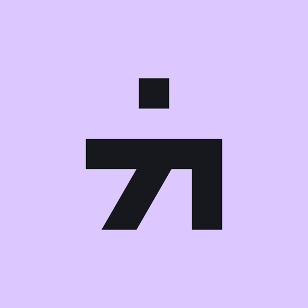
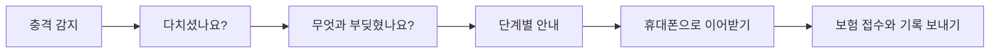
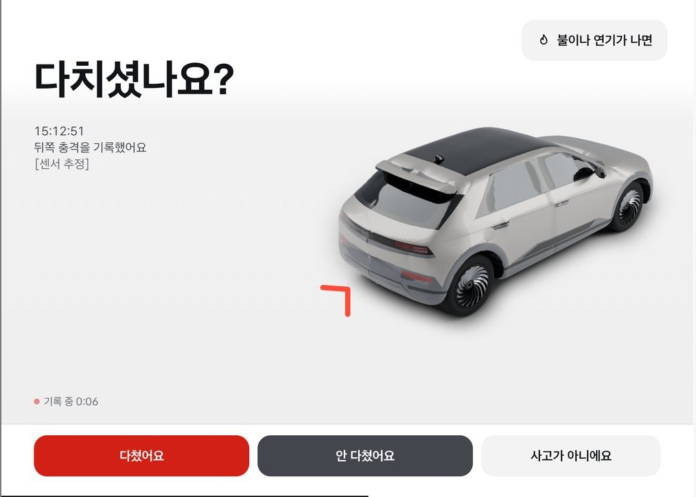
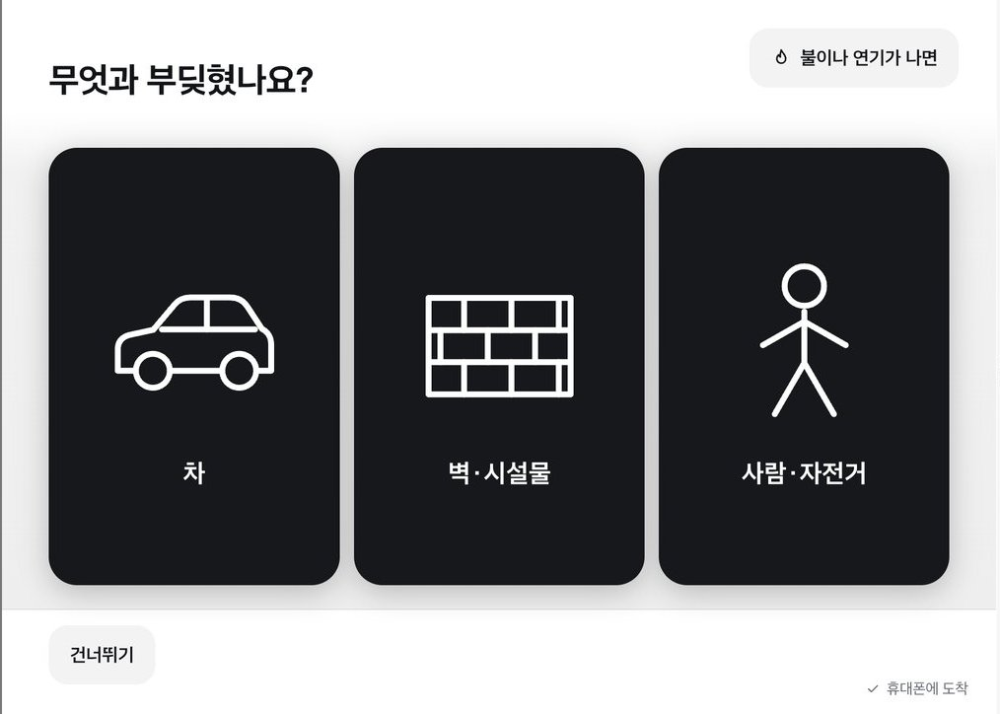
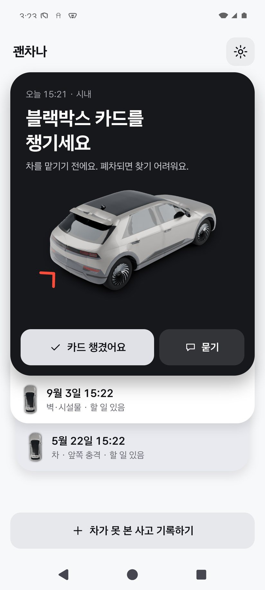
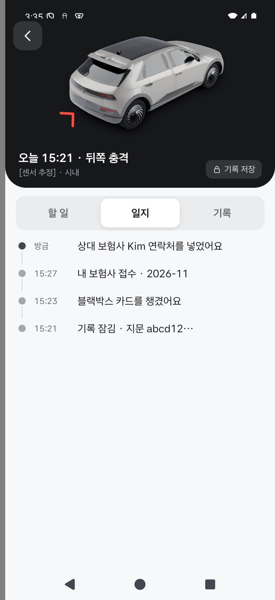
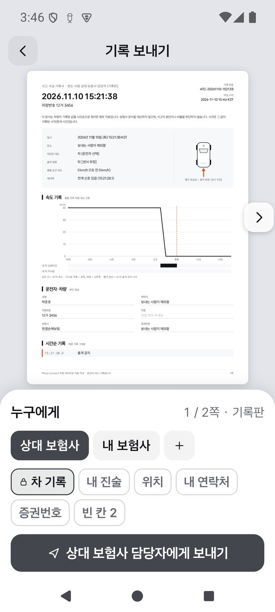
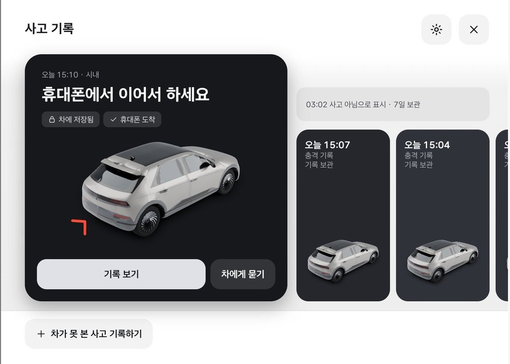

<p align="center">
  
</p>

<h1 align="center">괜차나</h1>

<p align="center"><b>교통사고가 난 순간, 차가 옆자리 사람처럼 곁에 있어 주는 앱</b></p>

<p align="center">Gwenchana · 현대자동차그룹 차량용 앱 공모전(Pleos App Market) 출품작</p>

---

## 어떤 앱인가요?

괜차나는 **자동차 화면에서 돌아가는 앱과 휴대폰 앱이 한 짝**인 사고 대처 서비스입니다.

사고가 나면 차가 먼저 알아채고 "다치셨나요?"라고 묻습니다. 무엇부터 해야 하는지 차분히 알려 주고, 사고 순간 차가 기록한 사실을 잘 정리해 둡니다. 차에서 내린 뒤에는 휴대폰이 이어받아 보험 접수까지 함께합니다.

이름 "괜차나"는 "괜찮아"와 "차"를 합친 말입니다. 놀란 사람에게 가장 먼저 건네고 싶은 말이기도 합니다.

## 왜 만들었나요?

퇴근길 신호 대기 중에 뒤에서 쾅, 하고 부딪혔다고 상상해 보세요.

머릿속이 하얘집니다. 비상등을 먼저 켜야 할까요, 차에서 내려야 할까요? 차를 옮겨도 될까요? 보험사에는 뭐라고 말해야 할까요? 며칠 뒤 담당자가 "그때 브레이크 밟으셨어요?"라고 물으면 정확히 기억이 날까요?

사고는 대부분의 사람에게 처음이거나 몇 년에 한 번 겪는 일입니다. 준비가 안 된 사람이 가장 당황한 순간에 가장 많은 판단을 해야 합니다.

그런데 그 순간의 속도, 브레이크, 방향지시등, 에어백 상태는 **차가 이미 알고 있습니다.** 괜차나는 차가 아는 것을 사람을 돕는 데 씁니다.

## 네 가지를 합니다

| | 하는 일 | 쉽게 말하면 |
|---|---|---|
| **1. 알아챕니다** | 에어백, 강한 충격, 갑작스러운 속도 변화로 사고를 감지합니다 | 평소에는 화면에 나타나지 않고 뒤에서 대기합니다 |
| **2. 알려 줍니다** | 상황에 맞는 대처 순서를 하나씩 안내합니다 | 한 화면에 할 일 하나, 고속도로와 시내는 순서가 다릅니다 |
| **3. 남겨 둡니다** | 사고 전 30초와 후 10초의 차량 기록을 저장합니다 | 시간표, 3D로 다시 그린 장면, 문서(PDF)로 만듭니다 |
| **4. 이어 갑니다** | 휴대폰으로 넘어가 접수와 후속 일을 챙깁니다 | 사고 한 건이 카드 한 장이 되어 끝날 때까지 다음 할 일을 알려 줍니다 |

## 사고가 나면 이렇게 흘러갑니다



### 1. 차가 먼저 묻습니다

충격을 감지하면 직전 기록부터 저장을 시작하고, 차가 멈춘 뒤 화면에 "다치셨나요?"를 띄웁니다. 달리는 중에는 운전을 방해하지 않도록 화면을 크게 가리지 않습니다.

버튼은 **다쳤어요**, **안 다쳤어요**, **사고가 아니에요** 세 개입니다. 다쳤다고 답하면 119 안내부터 시작합니다. 과속방지턱 같은 오해였다면 사고가 아니라고 누르면 됩니다(에어백이 터진 사고에서는 이 버튼이 나오지 않습니다). 차가 멈춘 뒤 나오는 안내 화면에는 "불이나 연기가 나면" 메뉴가 따로 있습니다.



### 2. 무엇과 부딪혔는지 고릅니다

차, 시설물, 사람 중에서 고르면 그에 맞는 안내로 바뀝니다. 잘 모르겠으면 건너뛸 수 있습니다. 다쳤다고 답했다면 이 단계 없이 119 안내로 바로 넘어갑니다.



### 3. 해야 할 일을 하나씩 알려 줍니다

비상등 켜기, 다친 사람 확인, 대피, 신고, 보험사 알리기, 사진 남기기 같은 일을 하나씩 안내합니다. 순서는 고속도로와 시내가 다르고, 음성으로도 읽어 줍니다.

안내 순서는 도로교통법, 도로교통공단 교재, 한국도로공사 안내 등 공개 자료를 참고해 정했습니다. 특정 기관의 공식 순서를 그대로 옮긴 것은 아닙니다. 예를 들어 고속도로에서는 사진보다 **대피가 먼저**입니다. 차가 비상등이 켜진 것을 알아차리면 다음 단계로 저절로 넘어갑니다.

### 4. 차는 입구, 휴대폰은 본거지

차에서 내리면 차 화면을 볼 수 없습니다. 그래서 휴대폰으로 알림이 오고, 보던 안내를 그대로 이어서 볼 수 있습니다.

| 휴대폰 홈 | 사고 일지 | 기록 보내기 |
|---|---|---|
|  |  |  |
| 지금 할 일이 맨 위에 나옵니다 | 무엇을 언제 했는지 남습니다 | 보낼 내용을 직접 고릅니다 |

휴대폰에서는 이런 일을 할 수 있습니다.

- **보험 접수 전화 원고:** 전화할 때 읽기만 하면 되도록 문장을 준비합니다. 접수번호도 적어 둘 수 있습니다.
- **기록 보내기:** 내 보험사나 상대 보험사 담당자에게 보낼 문서를 미리 보고, 내 진술·위치·연락처를 넣을지 고릅니다.
- **두 차 기록 맞대기:** 상대방도 동의하면 양쪽 기록을 나란히 놓고 볼 수 있습니다.
- **가족에게 맡기기:** 다쳐서 직접 챙기기 어려우면 등록해 둔 가족에게 넘길 수 있습니다.

### 5. 지난 사고는 언제든 다시 열어 봅니다

차 화면과 휴대폰 모두에 사고가 카드로 남습니다. 3D로 다시 그린 사고 장면과 시간표를 볼 수 있습니다.



## 사람마다 안내가 달라집니다

같은 사고라도 필요한 도움은 사람마다 다릅니다. 그래서 설정에서 안내 방식을 고를 수 있습니다.

| 이런 분께 | 안내 방식 | 이렇게 달라집니다 |
|---|---|---|
| 첫 사고가 걱정인 사회초년생 | **상세** | 일부 용어를 풀어 주고, 시내 사고에서는 안심시키는 말로 시작합니다 |
| 시간이 없는 직장인 | **간결** | 부가 설명과 안심 단계 없이 해야 할 일 위주로 진행합니다 |
| 글을 읽기 어려운 어르신 | **음성** | 제목을 크게 보여 주고 나머지는 음성으로 전합니다 |

보호자를 등록해 두면 가족에게 알리는 단계가 나오고(간결 방식 제외), 렌터카를 타고 있으면 보험사 대신 렌터카 회사에 알리도록 안내가 바뀝니다.

## 판사가 아니라 증인입니다

괜차나의 가장 중요한 원칙입니다. **앱은 누구 잘못인지 절대 판단하지 않습니다.**

휴대폰이나 차 화면의 "차에게 묻기"로 사고 순간을 물어볼 수 있습니다. 답은 인공지능이 지어내지 않고, 저장된 기록에서 그대로 찾아 보여 줍니다.

| 물어보면 | 차의 대답 |
|---|---|
| 브레이크는 언제 밟으셨어요? | 기록된 시각을 알려 줍니다 |
| 그때 속도는 얼마였어요? | 기록된 속도를 알려 줍니다 |
| 비상등은 언제 켜셨어요? | 기록된 시각을 알려 줍니다 |
| 누구 잘못이에요? | **"판단은 드리지 않아요. 제가 기록한 것은 이거예요."** |

운전자에게 불리한 기록도 숨기지 않고 그대로 보여 줍니다. 추측이 섞인 값에는 `[센서 추정]`처럼 표시를 붙여 사실과 구분합니다.

## 기록을 믿을 수 있게 하는 방법

사고 기록을 저장할 때 **파일 지문(SHA-256)** 을 함께 남깁니다. 파일 내용이 한 글자만 바뀌어도 지문이 달라지기 때문에, 차에 보관된 원본으로 지문을 다시 계산해 비교하면 저장 뒤 내용이 바뀌었는지 알 수 있습니다. 위조 자체를 막아 주는 장치는 아닙니다. 기록을 시각 순서대로 정리한 문서는 PDF로 만들어져 보험사 담당자에게 첨부 자료로 보낼 수 있습니다.

## 내 정보는 이렇게 다룹니다

- **평소에는 저장하지 않습니다.** 최근 60초만 임시 공간에 두고 계속 버립니다. 사고가 감지됐을 때만 저장합니다.
- **차에 저장된 기록은 30일이 지나면 자동으로 지웁니다.** "사고가 아니에요"로 표시한 기록은 7일 뒤에 지웁니다. 휴대폰으로 받은 기록과 사진은 로그아웃하거나 동의를 거두면 지워집니다.
- **동의를 거두면 바로 지웁니다.**
- **외부 AI 사용은 선택입니다.** 동의하면 경위 문장과 차 카메라 사진을 해외 AI 서비스(Anthropic)로 보내 문장을 다듬고 장면을 설명합니다. 처음부터 동의하지 않아도 다른 기능은 그대로입니다. 동의했다가 거두면 저장된 사고 기록이 모두 지워집니다.
- **119에 자동으로 전화하지 않습니다.** 전화는 언제나 사람이 직접 겁니다.

## 지금 어디까지 왔나요?

| 상태 | 내용 |
|---|---|
| **컴퓨터 안의 가상 차 화면(에뮬레이터)에서 동작 확인** | 사고 감지, 안내, 3D 재현, 사고 기록, 기록서 PDF, 휴대폰 이어받기 |
| **시제품 단계** | 차와 휴대폰을 잇는 서버는 아직 PC에서 켜는 시험용입니다. 실제 서버는 공모전 2차 발표 전에 준비합니다 |
| **아직 못 한 것** | **실제 차에서는 시험하지 못했습니다.** 일반 앱이 차의 충격 측정 센서와 카메라를 쓸 수 있는지는 공모전 운영 측의 답을 기다리고 있습니다 |

### 사고를 어떻게 시험했나요?

진짜 사고를 낼 수는 없어서, 정교한 자동차 물리 게임인 **BeamNG.drive**를 시험장으로 썼습니다. 게임에서 차를 부딪히면 그 값을 실제 차량 신호처럼 차량용 에뮬레이터(컴퓨터 안의 가상 자동차 화면)에 넣습니다. 정면, 뒤, 옆, 후진 충돌과 급제동 등을 자동으로 수십 번 반복해 감지와 재현을 점검했습니다.

앱은 **실제 차에도 있는 종류의 값만** 쓰도록 만들었습니다. 일부 센서를 일반 앱이 쓸 수 있는지는 위에 적은 대로 확인 중입니다. 게임만 아는 정답은 앱에 넣지 않고, 게임과 연결하는 코드는 제출용 앱에서 빠집니다.

---

# 심사위원·개발자용 안내

여기부터는 앱을 직접 설치해 보거나 코드를 볼 분을 위한 내용입니다. 팀원과 개발 도구용 설치 안내는 [CLAUDE.md](CLAUDE.md)에 있습니다.

## APK 위치

| 파일 | 내용 |
|---|---|
| [`apk/gwenchana_car_release.apk`](apk/gwenchana_car_release.apk) | 차 앱 (Pleos Connect 에뮬레이터용, release) |
| [`apk/gwenchana_phone_release.apk`](apk/gwenchana_phone_release.apk) | 휴대폰 앱 (release) |

패키지 이름은 개발 때 정한 `com.askthecar`입니다.

## 실행 방법 (심사용)

### 1. Pleos Connect 에뮬레이터

Pleos 개발자 문서대로 Android 14(API 34) Pleos Connect 시스템 이미지로 기기를 만듭니다. 개발에 쓴 설정은 2560×1440, 160dpi, RAM 4GB, x86_64, Cold boot, AVD 이름 `Pleos_Connect`입니다. 켜고 홈 화면이 뜰 때까지 기다립니다.

### 2. 차 앱 설치

에뮬레이터 이름이 다르면 `-s` 값을 바꾸세요.

```bash
adb -s emulator-5554 install -r -g apk/gwenchana_car_release.apk
```

사고 화면이 다른 앱 위에 뜨도록 허용합니다. 설치할 때마다 한 번씩 합니다.

```bash
adb -s emulator-5554 shell appops set --user 10 com.askthecar SYSTEM_ALERT_WINDOW allow
```

앱 목록에서 **괜차나**를 한 번 열어 동의합니다. 그 뒤로는 뒤에서 기록하며 대기합니다.

### 3. 사고 일으켜 보기

약 3.5g 충격을 넣고, 바로 값을 되돌립니다. "다치셨나요?" 화면이 뜨고, 고르는 대로 안내와 3D 재현, 사고 기록으로 이어집니다. 안내 단계의 전화 버튼을 누르면 실제 전화 앱이 열리니 주의하세요.

```bash
adb -s emulator-5554 emu sensor set acceleration 0:9.81:34
```

```bash
adb -s emulator-5554 emu sensor set acceleration 0:9.81:0
```

### 4. 휴대폰 앱까지 이어 보기

**현재 시제품의 제한**: 차와 휴대폰을 잇는 서버는 아직 PC에서 켜는 시제품(HTTP, 인증 없음)입니다. release APK는 평문 통신을 막으므로 위 APK끼리는 연결되지 않습니다. 연결을 보려면 debug로 빌드합니다. https 서버는 2차 발표 전에 준비합니다.

```bash
./gradlew :app:assembleDebug :phone:assembleDebug
```

```bash
python game/bridge/sync_server.py --one-account
```

휴대폰 에뮬레이터(`emulator-5556`)에 `phone-debug.apk`를 설치하고 로그인합니다. 서버 주소는 `http://10.0.2.2:8767`(실제 휴대폰은 `http://PC주소:8767`)입니다. 로그인 목록의 운전자 3명과 "가족"은 시제품용 가상 계정입니다.

## 테스트 환경과 필요한 설정

| 항목 | 값 |
|---|---|
| 검증한 기기 | Pleos Connect 에뮬레이터(Android 14 / API 34, x86_64, 2560×1440 160dpi, RAM 4GB), 운전자 사용자 10. 휴대폰은 Android 에뮬레이터 |
| 앱 | `com.askthecar` 0.1.0, minSdk 28, target/compile 35, ABI arm64-v8a·x86_64 |
| 빌드 도구 | JDK 17, Gradle 8.10.2(wrapper), AGP 8.8.2, Kotlin 2.1.21 |
| 차 앱 권한 | Pleos `CAR_DRIVE`·`CAR_LIGHTS`·`CAR_SAFETY`·`PRIVATE_CAR_SAFETY`·`CAR_DOORS`·`CONTROL_CAR_DOORS`·`TTS_SERVICE`·`STT_SERVICE`·`FUSED_LOCATION`·`NAVI_ROUTE`, AAOS `CAR_SPEED`·`CAR_POWERTRAIN`, 마이크, 카메라, 통화 상태, 포그라운드 서비스, 알림, 다른 앱 위 표시, 부팅 후 시작 |
| 네트워크 | 감지·안내·기록은 네트워크 없이 동작합니다. 휴대폰 연동은 동기화 서버가 필요합니다 |

**실제 차량에서는 아직 시험하지 않았습니다.** 일반 앱에 가속도·자이로 센서와 카메라가 열려 있는지는 미확인입니다. release는 공개 시험용으로 디버그 키로 서명했습니다.

### 공개 APK에서 꺼져 있는 것

APK를 풀면 안에 든 키가 보이기 때문에, 공개 APK에는 키를 넣지 않습니다.

| 기능 | 공개 APK | 켜는 방법 |
|---|---|---|
| 안내 음성 (Pleos TTS) | 소리 없음, 화면 안내는 그대로 | 자기 키로 빌드 |
| 경위서 문장 다듬기 (Claude) | 사실 목록을 그대로 표시 | 중계 서버를 배포하고 빌드 |

### 직접 빌드

프로젝트 맨 위에 `secrets.properties`를 만듭니다. 이 파일은 git에 올라가지 않습니다. 없어도 `-Ppublic` 빌드는 됩니다.

```properties
pleos.clientId=발급받은 값
pleos.clientSecret=발급받은 값
relay.url=배포한 중계 서버 주소(없으면 비움)
relay.token=중계 서버 토큰(없으면 비움)
```

JDK 17과 Android SDK 35가 필요합니다. `local.properties`에 `sdk.dir`을 적거나 `ANDROID_HOME`을 설정합니다.

```bash
./gradlew :app:assembleRelease :phone:assembleRelease -Ppublic
```

```bash
./gradlew :app:testDebugUnitTest :phone:testDebugUnitTest
```

## 사용한 Pleos SDK · AAOS API

| 쓰는 곳 | API |
|---|---|
| 조향·브레이크·지시등·에어백·크루즈·경고등·트렁크 | Pleos `Vehicle` 2.3.2 |
| 속도·기어 | AAOS `CarPropertyManager` |
| 위치 | Pleos `FusedLocation` 1.1.3 |
| 도로 제한속도 | Pleos `NaviHelper` 3.0.5 |
| 음성 안내 / 운전자 진술 | Pleos `TextToSpeech` 3.3.1 / `SpeechToText` 3.3.1 |
| 충격 감지 보조 | Android 가속도·자이로 센서 |
| 사고 순간 사진 | Android Camera2 |

## 구조

| 폴더 | 내용 |
|---|---|
| `apk/` | release APK |
| `app/` | 차 앱. `app/src/debug`는 게임 시험 전용이라 release APK에 들어가지 않습니다 |
| `phone/` | 휴대폰 앱 |
| `shared/` | 두 앱이 함께 쓰는 코드 |
| `game/` | PC 시험 도구: BeamNG 모드, 브리지, 동기화 서버, 자동 사고 시험 |
| `relay/` | 경위서 문장을 다듬는 중계 서버 (Cloudflare Worker) |
| `docs/` | 기획서, 실차 대응표, 조사 보고서 |

## 시험 방법

시험 순서는 [README_TEST.md](README_TEST.md), 값별 실차 출처는 [docs/실차_대응표.md](docs/실차_대응표.md)에 있습니다.

## 라이선스와 고지

사용한 오픈소스와 모델은 [NOTICE.md](NOTICE.md)를 보세요.

BeamNG.drive는 BeamNG GmbH의 게임이며, 이 프로젝트는 BeamNG와 제휴하지 않았습니다. 정식 구매한 게임을 시험 환경으로 썼고, 이 저장소와 APK에는 게임 파일이 들어 있지 않습니다. `game/beamng/mod`는 직접 작성한 모드입니다.
