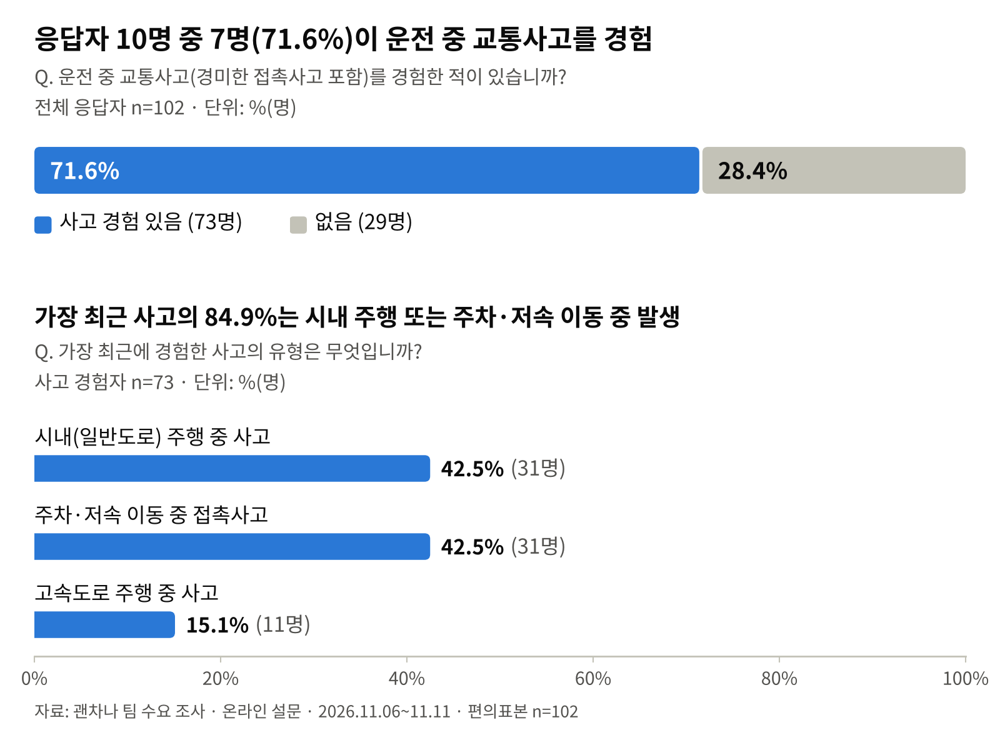
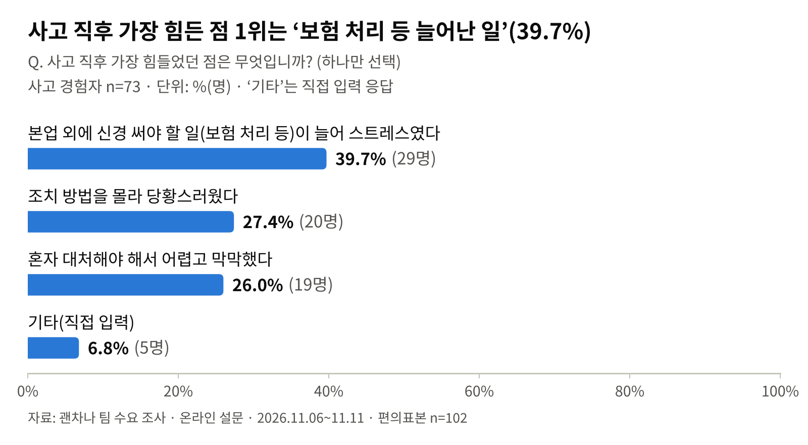
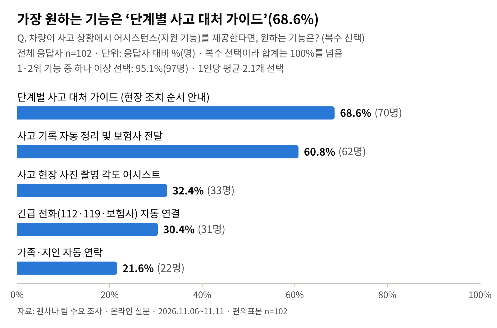

# 괜차나(Gwenchana) 시장조사: 자동차 사고 경험 및 사고 대응 어시스턴스 수요 조사

> 모든 수치는 집계값입니다. 이름·응답 시각·주관식 원문은 공개하지 않습니다.

## 조사 개요

| 항목 | 내용 |
|---|---|
| 조사명 | 자동차 사고 경험 및 차량 사고 대응 어시스턴스 수요 조사 |
| 응답 수 | **102명** (그중 운전 중 교통사고 경험자 **73명**) |
| 조사 기간 | 2026-11-06 ~ 2026-11-11 (첫 응답일~마지막 응답일, 한국 시간) |
| 조사 방법 | 온라인 설문. 응답 파일 형식(‘GMT+9’ 타임스탬프, 복수 응답을 ‘;’로 구분)으로 보아 Google 설문지로 수집된 것으로 보입니다. 배포 경로와 표본 추출 방식은 기록돼 있지 않아 편의표본으로 봅니다. |
| 문항 | 연령대 / 운전 중 교통사고 경험 여부 / (경험자만) 가장 최근 사고 유형, 사고 직후 가장 힘들었던 점 / 원하는 어시스턴스 기능(복수 선택) |
| 응답자 연령 | 20대 이하 23.5% · 30대 30.4% · 40대 22.5% · 50대 14.7% · 60대 6.9% · 70대 이상 2.0% |

**데이터 점검:** 이전 검토의 수치(응답자 102명, 사고 경험자 73명)는 원자료와 **일치**합니다(73/102 = 71.6%). 분석 문항에는 형식 오류나 빈 응답이 없습니다. 조건부 문항(사고 유형, 가장 힘들었던 점)은 경험자 73명 모두 답했고 무경험자의 응답은 없습니다. 복수 선택 문항은 ‘;’로 구분돼 있으며, 보기 문구 안에는 쉼표나 ‘;’가 없어 5개 보기로 정확히 나뉩니다. 이 문항에는 직접 입력 응답이 없습니다.

---

## 차트 1. 사고 경험 여부와 가장 최근 사고 유형

응답자의 71.6%(102명 중 73명)가 운전 중 교통사고(경미한 접촉사고 포함)를 겪었습니다. 이 표본에서 사고 대응은 소수가 아니라 다수가 겪어 본 일입니다. 가장 최근 사고의 84.9%(62명)는 시내 주행(42.5%) 또는 주차·저속 이동(42.5%) 중에 일어났고, 고속도로 사고는 15.1%였습니다. 저속 접촉사고에서는 에어백이 터지지 않는 경우가 많습니다. 그래서 에어백 신호뿐 아니라 차량 센서로도 충돌을 감지하는 괜차나의 설계가 중요하며, 저속 충돌 감지 정확도를 핵심 검증 항목으로 삼아야 합니다.

| 구분 | 기준 | 응답 수 | 비율 |
|---|---|---:|---:|
| 사고 경험 있음 | 전체 n=102 | 73명 | 71.6% |
| 사고 경험 없음 | 전체 n=102 | 29명 | 28.4% |
| 시내(일반도로) 주행 중 사고 | 경험자 n=73 | 31명 | 42.5% |
| 주차·저속 이동 중 접촉사고 | 경험자 n=73 | 31명 | 42.5% |
| 고속도로 주행 중 사고 | 경험자 n=73 | 11명 | 15.1% |

## 차트 2. 사고 직후 가장 힘들었던 점 (사고 경험자)

사고 경험자(73명)가 꼽은 사고 직후 가장 힘든 점 1위는 ‘본업 외에 신경 써야 할 일(보험 처리 등)이 늘어 스트레스’(39.7%)였습니다. 괜차나는 사실 중심의 사고 보고서를 자동으로 작성하고 기록을 휴대폰으로 보내 주는데, 바로 이 부담을 겨냥한 기능입니다. 하나만 고르는 문항이므로 ‘조치 방법을 몰라 당황’(27.4%)과 ‘혼자 대처해야 해서 막막’(26.0%)을 합산할 수 있으며, 합하면 53.4%(39명)입니다. 절반 이상이 현장 대처 자체를 가장 힘들어했다는 뜻이고, 차량 화면에서 비상등 켜기 → 안전한 곳으로 이동 → 119/112 신고를 한 단계씩 안내하는 괜차나 가이드가 필요한 이유입니다.

| 가장 힘들었던 점 (경험자 n=73, 하나만 선택) | 응답 수 | 비율 |
|---|---:|---:|
| 본업 외에 신경 써야 할 일(보험 처리 등)이 늘어 스트레스였다 | 29명 | 39.7% |
| 조치 방법을 몰라 당황스러웠다 | 20명 | 27.4% |
| 혼자 대처해야 해서 어렵고 막막했다 | 19명 | 26.0% |
| 기타(직접 입력, 원문 비공개) | 5명 | 6.8% |

## 차트 3. 원하는 사고 대응 어시스턴스 기능 (복수 선택)

응답자의 68.6%가 ‘단계별 사고 대처 가이드’를, 60.8%가 ‘사고 기록 자동 정리 및 보험사 전달’을 원했고, 95.1%(97명)는 둘 중 하나 이상을 골랐습니다. 이 두 기능은 괜차나의 핵심 기능에 그대로 대응합니다. 하나는 차량 화면의 단계별 안전 안내이고, 다른 하나는 충돌 전 30초·후 10초 기록 저장과 사실 중심 보고서 작성·휴대폰 전송입니다. 다만 현재 설명된 기능을 기준으로 하면 두 기능 모두 일부만 해당하는 부분이 있습니다.

- ‘보험사 전달’은 휴대폰으로 기록을 보내는 데까지만 해당합니다.
- ‘긴급 전화 자동 연결’(30.4%)은 119/112 신고를 안내하는 데까지만 해당합니다.
- ‘사진 촬영 각도 어시스트’(32.4%)와 ‘가족·지인 자동 연락’(21.6%)은 현재 범위 밖이므로 후속 기능 후보로 볼 수 있습니다.

| 원하는 기능 (전체 n=102, 복수 선택) | 선택 수 | 응답자 대비 |
|---|---:|---:|
| 단계별 사고 대처 가이드 (현장 조치 순서 안내) | 70명 | 68.6% |
| 사고 기록 자동 정리 및 보험사 전달 | 62명 | 60.8% |
| 사고 현장 사진 촬영 각도 어시스트 | 33명 | 32.4% |
| 긴급 전화(112·119·보험사) 자동 연결 | 31명 | 30.4% |
| 가족·지인 자동 연락 | 22명 | 21.6% |

복수 선택이라 합계는 100%를 넘습니다. 1인당 평균 2.1개를 골랐습니다.

---

## 한계

- **표본 크기:** 응답자는 102명, 사고 경험자는 73명입니다. 단순무작위표본이라고 가정해도 비율의 95% 오차범위는 최대 약 ±9.7%p(n=102), ±11.5%p(n=73)입니다. 실제로는 편의표본이라 이 수치조차 그대로 적용되지 않습니다. 사고 경험 유무별 기능 선호(CSV의 `Q5_features_by_exp_*`)는 무경험자가 29명뿐이라 집단 간 차이로 해석하지 않습니다.
- **편의표본:** 무작위로 추출하지 않았고 배포 경로도 기록돼 있지 않아, 결과를 전체 운전자로 일반화할 수 없습니다. 주제에 관심이 있거나 사고를 겪은 사람이 더 많이 응답했을 가능성(자기선택 편향)도 있습니다.
- **연령 편중:** 20~40대가 76.5%(78명)이고, 50대는 14.7%, 60대 이상은 8.8%(9명)에 그쳐 고령 운전자의 의견이 적게 반영됐습니다. 연령대별 차이는 이 표본으로 판단하기 어렵습니다.
- **문항 설계:**
  - 운전 여부·경력·빈도를 묻지 않아, ‘사고 경험 없음’에 비운전자가 섞였을 수 있습니다.
  - 기능 문항은 제시된 5개 보기 중에서 고르는 방식입니다. 그래서 보기 밖의 수요나 지불 의향은 측정하지 못했고, 보기 문구가 서비스 콘셉트와 가까워 선택이 유도됐을 수 있습니다.
  - ‘가장 최근 사고’에 대한 답은 기억에 의존합니다(회상 편향).
- **기타 응답:** 직접 입력 5건은 개인정보 보호를 위해 원문을 공개하지 않고 ‘기타’로만 집계했습니다.

## 제안서 ‘시장조사’ 섹션용 단락

> 괜차나 팀이 2026년 11월 6일부터 11일까지 진행한 온라인 수요 조사(응답자 102명)에서 응답자의 71.6%(73명)가 운전 중 교통사고(경미한 접촉사고 포함)를 경험했다고 답했다. 사고 경험자가 꼽은 사고 직후 가장 힘든 점은 ‘보험 처리 등 늘어난 일’(39.7%)이었고, ‘조치 방법을 몰라 당황스러웠다’(27.4%)와 ‘혼자 대처해야 해서 막막했다’(26.0%)를 합하면 53.4%가 현장 대처 자체를 가장 큰 어려움으로 들었다. 원하는 지원 기능으로는 ‘단계별 사고 대처 가이드’(68.6%)와 ‘사고 기록 자동 정리 및 보험사 전달’(60.8%)이 가장 많았으며, 응답자의 95.1%가 둘 중 하나 이상을 선택했다. 이는 충돌을 감지하면 차량 화면에서 안전 조치를 한 단계씩 안내하고 사고 전후 기록을 사실 중심 보고서로 정리해 휴대폰으로 보내는 괜차나의 핵심 기능과 직접 맞닿는 수요다(다만 편의표본이므로 전체 운전자로 일반화하는 데는 한계가 있다).

---

## 파일

| 파일 | 설명 |
|---|---|
| `chart1_accident_experience_type.png` / `.svg` | 차트 1: 사고 경험 여부(n=102)와 최근 사고 유형(n=73) |
| `chart2_hardest_after_accident.png` / `.svg` | 차트 2: 사고 직후 가장 힘들었던 점(n=73) |
| `chart3_wanted_features.png` / `.svg` | 차트 3: 원하는 어시스턴스 기능(n=102, 복수 선택) |
| `chart3b_wanted_features_experienced.png` / `.svg` | 차트 3b: 원하는 어시스턴스 기능, 사고 경험자 기준(n=73, 복수 선택). 제안서의 ‘사고를 겪어 본 73명 가운데 64%·60%’ 문장과 짝을 이루는 차트 |
| `survey_aggregates.csv` | 문항별 집계만 담은 CSV(UTF-8). 열: `question_id, question, type, base, base_n, option, count, percent` |

- PNG는 가로 1600px이며, A4 본문 폭(약 16cm)에 맞춰 넣으면 글자가 약 7.5~12pt로 보입니다. Google 문서에는 PNG를 넣으세요(Google 문서는 SVG 삽입을 지원하지 않습니다).
- SVG는 글자를 도형으로 바꿔 두어서 글꼴이 없는 환경(GitHub 등)에서도 똑같이 보입니다.
- 차트 글꼴: Noto Sans CJK KR. 막대는 모두 0%에서 시작합니다.
